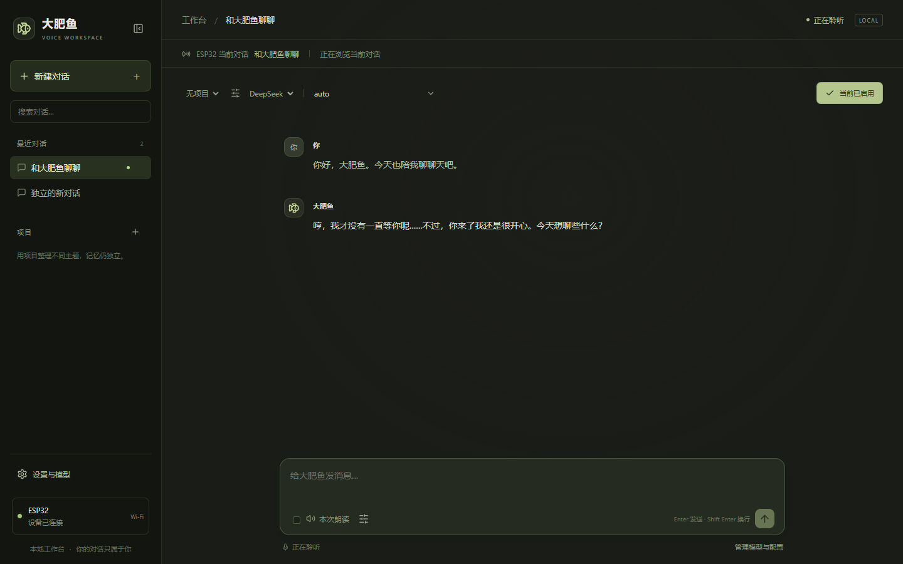

# 与大肥鱼对话

一套已在真实ESP32上跑通过的桌面语音伙伴：**说话 → 本地识别 → DeepSeek回答 → 本地语音合成 → 喇叭发声**。

包含ESP32固件源码与公开演示配置的预编译固件、React本地网页、Python服务、参考音、接线与烧录说明。浏览器可以管理独立对话、项目、LLM选择，以及ASR/LLM/TTS的本地/API配置。默认角色是可爱、甜甜的轻傲娇“大肥鱼”。

> **为什么作者用热点？** 因为校园网有额外认证，ESP32不方便直接接入，所以用手机热点做联调。**热点不是硬性要求：有普通Wi-Fi时，ESP32直接连它的2.4GHz网络，电脑接入同一可互通局域网即可。** 电脑可用同路由器的网线或5GHz频段。详见[联网说明](docs/NETWORK.md)。

## 从哪里开始

| 你要做什么 | 看这里 |
|---|---|
| 购买硬件、按表接线 | [硬件清单与接线](docs/HARDWARE.md) |
| 安装Python、下载模型、第一次运行 | [从零安装](docs/INSTALL.md) |
| 给ESP32烧录或修改普通Wi-Fi配置 | [详细烧录教程](docs/FLASHING.md) |
| 日常打开网页、切换对话、恢复默认 | [网页使用](docs/USAGE.md) |
| 换DeepSeek/OpenAI/本地LLM或ASR/TTS API | [模型与API配置](docs/MODELS.md) |
| 显存、速度、哪些结果真正测过 | [性能与验证边界](docs/PERFORMANCE.md) |
| 修改代码、增加其他接口 | [结构与扩展](docs/DEVELOPMENT.md) |
| 无声音、COM口、模型加载等问题 | [排查](docs/TROUBLESHOOTING.md) |

下载仓库ZIP或Release整包，解压到例如`C:\dafe-chat`。**这是本地网页项目，不是包含模型和Python的免安装EXE**；环境只需首次安装。预构建网页已包含，普通使用不需要Node/npm。

## 最短复现路线

1. 准备经典ESP32-WROOM-32/DevKit V1（4MB Flash）、INMP441、MAX98357A和4Ω/3W喇叭，严格按接线表连接。
2. 在Windows 10/11 x64安装Python 3.12和合适的NVIDIA驱动，双击`安装依赖.cmd`。会创建项目自己的`.venv`，不会改你的其他Python环境。
3. 双击`首次配置.cmd`，填自己的网络和DeepSeek Key；双击`下载模型.cmd`。也可以在网页中改用外部模型服务，不用作者的Key。
4. 按[烧录教程](docs/FLASHING.md)烧入固件。预编译版连接公开演示网络`DAFE_DEMO`；连接自己的普通Wi-Fi时，按教程用自己的SSID/密码重新编译。
5. 双击`启动大肥鱼.cmd`，打开 **http://127.0.0.1:18766/**，等待模型就绪和ESP32连接。
6. 选择对话后点“确定启用”，再讲话。等喇叭回答完再说下一句。退出用`关闭大肥鱼.cmd`。

密钥、网络配置、聊天记录、录音和设备原固件备份均写到被忽略的`.private/`或`runtime/`，**本仓库没有作者的API Key、私人Wi-Fi配置、聊天数据库或聊天录音**。随附`jm-tech`是经允许公开的参考音，不是聊天录音。

## 默认模型与设备

- **ASR**：FunASR Paraformer中文流式模型`iic/speech_paraformer-large_asr_nat-zh-cn-16k-common-vocab8404-online`，CPU 6线程、600ms解码块。
- **LLM**：DeepSeek API，默认关闭思考；从账号可用模型中解析，必要时在网页手填模型ID。也支持OpenAI兼容接口、Ollama、LM Studio。
- **TTS**：OpenBMB VoxCPM2，本地CUDA、48kHz；`jm-tech`音频+逐字转写固定音色，5步、CFG2.0、seed0。
- **电脑实测**：RTX4060Ti **16GB**，Python3.12.7、PyTorch2.6.0+cu126。官方给VoxCPM2的参考显存约8GB；本工程没有验证8GB卡一定可用，详见性能文档。
- **ESP32**只负责16kHz采集、Wi-Fi传输和48kHz播放，不在板上运行大模型。原型为轮流对话，没有AEC或播放中插话。

## 已验证的功能

原型已完成真实麦克风问答、固定音色及“A记住信息 → B不知道 → 切回A仍记得”的硬件验收。32项电脑测试覆盖流式发送、取消、配置/摘要隔离、加载回滚、音频转换与API请求协议；公开整理版另行通过32项测试并重新编译了公开演示固件。

尚未在另一台全新电脑上完整安装验证；其他厂商接口没有全部使用真实账号逐一联调。不要把协议测试当作所有厂商、所有显卡、所有热点均已通过。

原创软件与文档使用[MIT许可证](LICENSE)。VoxCPM推理源码快照、Espressif组件和前端依赖保留各自许可证，见[第三方说明](THIRD_PARTY_NOTICES.md)；模型权重单独下载，遵循上游许可。
