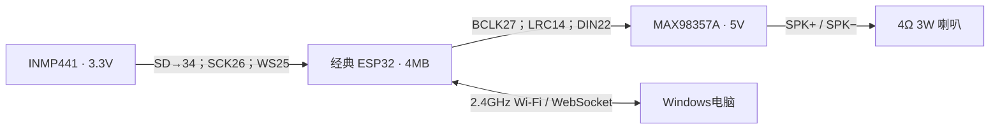

# 硬件清单与唯一接线表

## 按这些名称就能搜索购买

| 数量 | 名称/搜索关键词 | 本工程要求与已测型号 |
|---|---|---|
| 1 | ESP32 DevKit V1 / ESP32-WROOM-32 开发板 | 经典ESP32，4MB Flash，双I²S；实测芯片ESP32-D0WD-V3 rev3.1，CP210x USB串口，常见30针Micro-USB板 |
| 1 | INMP441 I²S 数字麦克风模块 | 6针，VDD/GND/SCK/WS/SD/LR。不是ADMP441或模拟麦克风 |
| 1 | MAX98357A I²S 数字功放模块 | 必须A版标准Philips I²S；B版左对齐协议不作为直接替代 |
| 1 | 4Ω 3W 喇叭 | 两根线接功放差分输出；本机喇叭背面无标注，参数来自购买资料 |
| 1 | 面包板 | 容纳开发板和两个模块 |
| 若干 | 杜邦线 | 公/母按模块排针选择；排针需焊牢，尽量缩短信号线 |
| 1 | USB数据线 | 与开发板接口匹配，需支持数据，不能只有供电 |

ESP32-S3/S2/C3不属于本版即插即用替代型号；也不需要OLED、额外Wi-Fi模块或PSRAM。

## 接线

| 模块 | 引脚 | 接到ESP32/目标 |
|---|---|---|
| INMP441 | VDD | **3V3，绝不能接5V** |
| INMP441 | GND | GND |
| INMP441 | SCK | GPIO26 / D26 |
| INMP441 | WS | GPIO25 / D25 |
| INMP441 | SD | GPIO34 / D34，只作输入 |
| INMP441 | L/R | GND，选择左声道 |
| MAX98357A | BCLK | GPIO27 / D27 |
| MAX98357A | LRC/LRCLK | GPIO14 / D14 |
| MAX98357A | DIN | GPIO22 / D22 |
| MAX98357A | GND | GND，与ESP32、麦克风共地 |
| MAX98357A | VCC/VIN | 已确认的稳定5V供电 |
| MAX98357A | SPK+、SPK− | 分别接喇叭两端，**SPK−不接地** |
| MAX98357A | GAIN | 本机悬空，常见模块对应默认9dB；以实物电路为准 |
| MAX98357A | SD/MODE | 本机悬空，购买资料原理图有1M上拉；无板载使能电阻的模块不能照此假定已使能 |

作者实物中功放VCC用杜邦线接USB供电开发板的VIN，未用仪表确认该点电压。复现时应查该板原理图或实测：**不是所有板子的VIN都能当作USB 5V输出**。不确定时使用已知稳定5V供电功放，保持共地，避免把外部5V反灌ESP32或接入GPIO/3V3。

GPIO是本工程通过GPIO矩阵指定的映射，不是芯片固定I²S脚。不要套用商家Arduino示例中的另一组脚位。面包板照片无法替代逐根核对；断电检查后再上电，端子须压住导线金属部分。

## 音频与质量边界

麦克风：16kHz、双32位I²S槽、取左声道，将24位数据转换成单声道PCM16上传。功放：48kHz、双32位Philips I²S槽，PCM16放高16位并复制左右声道，目标LRCLK48kHz、BCLK3.072MHz。

固件默认音量25%，待机关闭TX，只有回答时发声。独立测试音已禁用。MAX98357A输出是差分功率信号，喇叭不直接接收数字音频。此面包板小喇叭原型不是Hi-Fi设备；已完成清晰问答，但长期供电裕量、失真和电磁兼容没有仪表认证结论。

## 原厂资料

- [Espressif ESP32-WROOM-32资料](https://www.espressif.com/sites/default/files/documentation/esp32-wroom-32_datasheet_en.pdf)
- [INMP441数据手册](https://invensense.tdk.com/wp-content/uploads/2015/02/INMP441.pdf)
- [MAX98357A/MAX98357B数据手册](https://www.analog.com/media/en/technical-documentation/data-sheets/MAX98357A-MAX98357B.pdf)
- [ESP-IDF5.3.4 I²S新驱动](https://docs.espressif.com/projects/esp-idf/en/v5.3.4/esp32/api-reference/peripherals/i2s.html)

资料按链接查阅原厂最新版本；第三方开发板的VIN和模块SD/GAIN电阻仍要核对实物。
